# EVA Wrist-Pad | Mount Sharp Boxwork Sector — Interplanetary Survival & Decision Support System

[](https://www.spaceappschallenge.org/)
[](https://nextjs.org/)
[](https://www.typescriptlang.org/)
[](https://trpc.io/)
[](https://trek.nasa.gov/tiles/apidoc/trekAPI.html?body=mars)

> **Full Project Papers:**  
> - 📄 **[Academic Paper in English (`PAPER_PROJECT_DOCUMENTATION_EN.pdf`)](./PAPER_PROJECT_DOCUMENTATION_EN.pdf)**  
> - 📄 **[Documento Técnico en Español (`PAPER_DOCUMENTACION_PROYECTO.pdf`)](./PAPER_DOCUMENTACION_PROYECTO.pdf)**  
> - 🧭 **[Mission Design & Engineering Guide (`GUIA_PROYECTO_SUPERVIVENCIA_INTERPLANETARIA.pdf`)](./GUIA_PROYECTO_SUPERVIVENCIA_INTERPLANETARIA.pdf)**

---

## 1. Project Name

**Official Title:**  
**EVA Wrist-Pad: Mount Sharp Boxwork Sector — Interplanetary Survival & Decision Support System**  
*(Repository / Prototype Identifier: `miniMars-SpaceApp`)*

---

## 2. Executive Summary (*Abstract*)

Transitioning from robotic surface reconnaissance to future crewed expeditions on Mars requires real-time operational decision-support architectures capable of simultaneously synthesizing orbital topography, in-situ environmental telemetry, geological science value, and life-critical **Portable Life Support System (PLSS)** constraints. **EVA Wrist-Pad** is an interactive web application that emulates a **tactical astronaut wrist-mounted tablet** operating across the polygonal mineral ridge (*Boxwork*) formations of **Mount Sharp (Aeolis Mons)** within **Gale Crater, Mars** ($\text{Lat. } -4.6805^\circ\text{ to } -4.6854^\circ\text{ N}, \text{Lon. } 137.3612^\circ\text{ to } 137.3668^\circ\text{ E}$).

Unlike passive cartographic viewers or gamified simulations that silently interpolate missing planetary measurements, **EVA Wrist-Pad** enforces a **strict epistemological and scientific data-honesty framework**. The platform fuses the official multi-resolution orbital imagery pyramid from **NASA Mars Trek OGC WMTS** (Viking MDIM 2.1, MRO CTX at $5\text{ m/px}$, MRO HiRISE at $0.25\text{ m/px}$, MGS MOLA laser altimetry, and Mars Odyssey THEMIS IR thermal inertia) with verifiable historical surface records collected by the **MSL Curiosity** rover (RAD, REMS, ChemCam, MAHLI, APXS, and Mastcam instruments across Sols 4189–4844). Built upon this empirical foundation, a deterministic **tRPC and TypeScript** computation engine evaluates two operational paradigms—**Solo Astronaut** versus **Astronaut Accompanied by a Support Rover**—governed by an explicit metabolic oxygen consumption model ($0.076\text{ kg O}_2/\text{h}$, derived from *NASA BVAD*) and a **4-Step Detour Decision Rule** in which biomechanical slope limits ($>22^\circ$) and mandatory return life-support reserves ($\ge 25\%\text{ O}_2$) function as non-negotiable safety filters prior to scientific optimization.

---

## 3. Interface Preview & System Walkthrough

### 3.1. Top Telemetry Bar, Mission Mode Selector & Sequential EVA Player
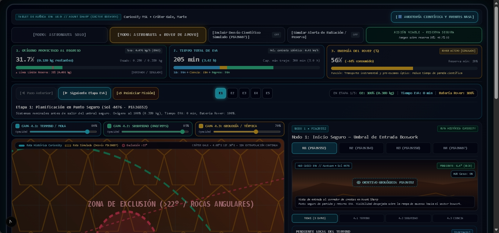

### 3.2. Multi-Layer Tactical Map & Node Provenance Drawer (`[MEASURED]`, `[DERIVED]`, `[SIMULATED]`)
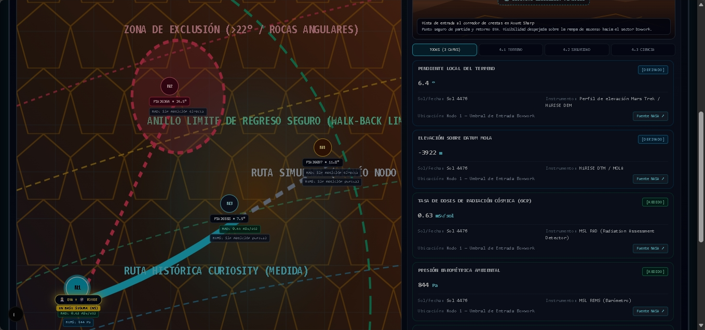

### 3.3. MOLA Topographic Elevation Profile & 4-Step Decision Engine Verdict
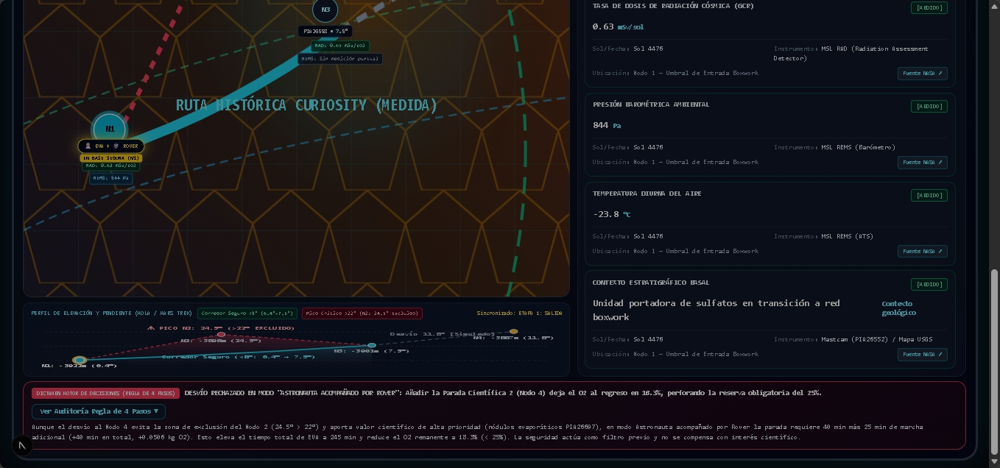

### 3.4. Integrated Scientific Audit Modal (3-Tab Jury Verification Suite)
| Tab A: Data Honesty Matrix (27 Records) | Tab B: Mathematical Survival Model | Tab C: Official Linked NASA Sources (8) |
| :---: | :---: | :---: |
| 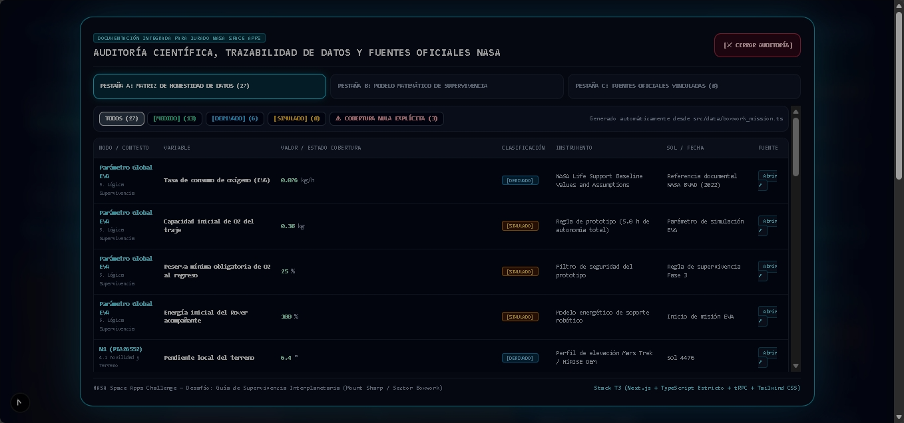 | 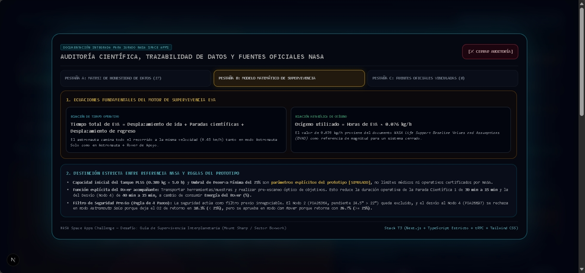 | 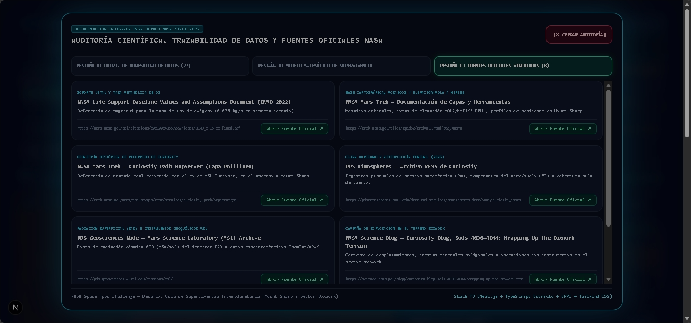 |

---

## 4. What Did We Develop? (*System Architecture & Technical Implementation*)

We engineered an end-to-end EVA planning, sequential mission playback, and scientific auditing platform designed around the ergonomics of a **16:9 panoramic wrist-mounted Heads-Up Display (HUD)** (`src/components/WristTabletHUD.tsx`), featuring high-contrast tactile controls optimized for pressurized EVA gloves.

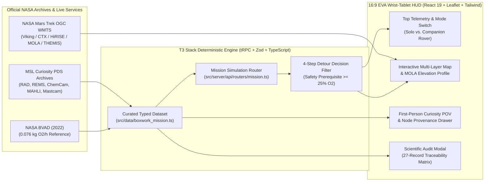

### 4.1. Multi-Layered Orbital Cartographic Engine (`MarsTrekLeafletMap.tsx`)
Streams live **NASA/JPL Solar System Treks** OGC WMTS tiles in Equirectangular projection (`EPSG:4326`):
- **Layer 4.1 — Mobility & Terrain:** Multi-resolution pyramid (Viking $232\text{ m/px} \rightarrow$ CTX $5\text{ m/px} \rightarrow$ HiRISE $0.25\text{ m/px}$), **MGS MOLA** shaded relief altimetry, *Curiosity*'s actual historical traverse polyline, and an interactive longitudinal topographic profile (`ElevationProfile.tsx`) from $-3922\text{ m}$ to $-3887\text{ m}$.
- **Layer 4.2 — Safety & Survival:** Topographic hazard rings, critical slope exclusion zones ($>22^\circ$), and point-specific Galactic Cosmic Ray (**MSL RAD**, $\text{mSv/sol}$) and meteorological (**MSL REMS**, $\text{Pa}$, $^\circ\text{C}$) records.
- **Layer 4.3 — Scientific Interest & Thermal Inertia:** **Mars Odyssey THEMIS Day IR ($100\text{ m}$)** thermal inertia mosaic paired with **ChemCam (LIBS)** and **MAHLI** sampling targets.

### 4.2. Four-Node Geological Traverse & First-Person Curiosity POV Gallery
Each node in `src/data/boxwork_mission.ts` is anchored to authentic **NASA/JPL Photojournal** imagery stored locally in `public/imagenes/`:

| Node 1 (`PIA26552`, Sol 4476) | Node 2 (`PIA26364`, Sol 4189) | Node 3 (`PIA26558`, Sol 4541) | Node 4 (`PIA26697`, Sol 4636) |
| :---: | :---: | :---: | :---: |
| 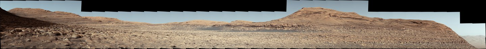 | 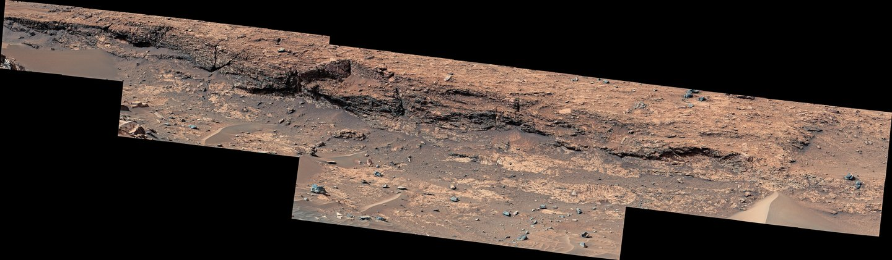 | 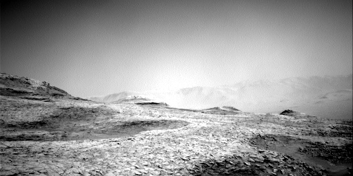 | 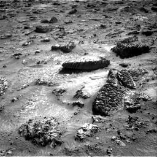 |
| **Safe Base Ingress** | **Exclusion Talus ($24.5^\circ > 22^\circ$)** | **Science Stop 1: Boxwork Ridges** | **Science Stop 2: Simulated Detour** |
| Slope $6.4^\circ$ • Elev. $-3922\text{ m}$ • RAD $0.63\text{ mSv/sol}$ • REMS $844\text{ Pa}$ | Blocked by biomechanical safety filter (angular blocks & steep slope) | Slope $7.5^\circ$ • ChemCam $\text{CaSO}_4$ veins • Stop: $30\text{ min}$ (Solo) / $15\text{ min}$ (Rover) | Slope $11.8^\circ$ • MAHLI evaporitic nodules • Stop: $40\text{ min}$ (Solo) / $15\text{ min}$ (Rover) |

### 4.3. Deterministic EVA Survival Equations (`src/server/api/routers/mission.ts`)

$$\text{Total EVA Time (min)} = t_{\text{outbound}} + \sum t_{\text{science stops}}(\text{mode}) + t_{\text{return}} + t_{\text{solar contingency}}$$

$$\text{O}_2\text{ Consumed (kg)} = \left(\frac{\text{Total EVA Time}}{60}\right) \times 0.076\text{ kg/h}$$

$$\text{Remaining O}_2\text{ (\%)} = \left(\frac{0.380\text{ kg} - \text{O}_2\text{ Consumed}}{0.380\text{ kg}}\right) \times 100$$

- **Constant Walking Speed ($0.45\text{ km/h}$):** The astronaut walks the entire route in both modes ($80\text{ min}$ outbound base, $80\text{ min}$ return base, $+25\text{ min}$ round-trip walk for Node 4 detour).
- **Explicit Companion Rover Role:** Transports geological tools/samples and performs optical pre-scanning of outcrops, reducing stationary science time at Node 3 ($30 \rightarrow 15\text{ min}$) and Node 4 ($40 \rightarrow 15\text{ min}$) in exchange for **Rover Battery Energy (%)** ($\text{minimum reserve } \ge 20\%$).

### 4.4. Strict Epistemological Traceability (`TelemetryRecord`)
Every data point is classified into one of three strict categories, plus explicit null handling:
- **`[MEASURED]` (`medido`):** Empirical in-situ readings from *Curiosity* instruments (RAD, REMS, ChemCam, MAHLI, Mastcam).
- **`[DERIVED]` (`derivado`):** Quantities computed from orbital DEMs (MOLA / HiRISE) or *NASA BVAD* baseline references.
- **`[SIMULATED]` (`simulado`):** Explicit prototype operational rules (PLSS $0.38\text{ kg}$ tank, $25\%$ reserve limit, Node 4 detour path).
- **Explicit Null Coverage (`valor: null`):** Where sensor readings do not exist for a given Sol or untraversed slope, the system explicitly reports `null` coverage with an explanatory note—**never extrapolating silently**.

---

## 5. How Does It Address the Challenge? (*4-Step Decision Matrix*)

Our **4-Step Detour Decision Engine** (`DecisionEnginePanel.tsx`) demonstrates how human-robotic teaming resolves the core trade-off between scientific exploration and human survival:

| Operational Mode | Selected Traverse | Total EVA Time | $\text{O}_2$ Consumed ($\text{kg}$) | Remaining $\text{O}_2$ at Return | Remaining Rover Battery | Survival Engine Verdict |
| :--- | :--- | :---: | :---: | :---: | :---: | :--- |
| **Solo Astronaut** | Base Route (N1 $\rightarrow$ N3 $\rightarrow$ N1) | $190\text{ min}$ | $0.2407\text{ kg}$ | **$36.7\%$** ($\ge 25\%$) | N/A (At Base) | **NOMINAL / MISSION VIABLE** |
| **Solo Astronaut** | With Detour (N1 $\rightarrow$ N3 $\rightarrow$ N4 $\rightarrow$ N1) | $255\text{ min}$ | $0.3230\text{ kg}$ | **$15.0\%$** ($< 25\%$) | N/A (At Base) | **DETOUR REJECTED (Breaches 25% Reserve)** |
| **With Support Rover** | Base Route (N1 $\rightarrow$ N3 $\rightarrow$ N1) | $175\text{ min}$ | $0.2217\text{ kg}$ | **$41.7\%$** ($\ge 25\%$) | **$56.0\%$** ($\ge 20\%$) | **NOMINAL / OPTIMAL MARGIN** |
| **With Support Rover** | With Detour (N1 $\rightarrow$ N3 $\rightarrow$ N4 $\rightarrow$ N1) | $215\text{ min}$ | $0.2723\text{ kg}$ | **$28.3\%$** ($\ge 25\%$) | **$32.0\%$** ($\ge 20\%$) | **DETOUR APPROVED (Extra Science Within Safe Reserve)** |

---

## 6. Why Is It Important? (*Impact & Significance*)

1. **Quantifying Human-Robotic Synergy on Mars:** Demonstrates mathematically that a companion rover does not need to carry the astronaut physically to save lives; acting as a **scientific force multiplier** during sampling stops preserves critical PLSS oxygen reserves ($\ge 25\%$).
2. **Epistemological Integrity Against Cartographic Hallucination:** Eliminates fabricated continuous heatmaps by teaching users that real planetary telemetry is discrete, Sol-dependent, and subject to sensor coverage gaps.
3. **Democratizing NASA Planetary Archives:** Transforms complex PDS Geosciences/Atmospheres tables, Mars Trek OGC WMTS layers, and NASA BVAD life-support standards into an intuitive first-person tactical HUD on Mount Sharp.

---

## 7. Quick Start & Local Development

### Prerequisites
- **Node.js** $\ge 20.x$ and **npm**

### Installation & Execution
```bash
# 1. Clone the repository
git clone https://github.com/your-username/miniMars-SpaceApp.git
cd miniMars-SpaceApp

# 2. Install dependencies
npm install

# 3. Start the development server
npm run dev
```
Open `http://localhost:3000` in your browser to launch the **EVA Wrist-Pad HUD**.

### Type-Checking & Production Build
```bash
npm run typecheck
npm run build
```

---

## 8. Artificial Intelligence Usage & Transparency Disclosure

In full compliance with the **NASA Space Apps Challenge** guidelines on transparency and academic integrity, the team declares the use of conversational Artificial Intelligence assistants as collaborative engineering and documentation support tools during the development lifecycle:

- **Google AI Ecosystem (Gemini):** Assisted with T3 Stack (`Next.js`, `TypeScript`, `tRPC`) software architecture, tactical HUD component layout, and technical paper structuring.
- **OpenAI ChatGPT (Model 6 Luna):** Assisted with conceptual synthesis of EVA operational scenarios, edge-case brainstorming, and mission workflow organization.
- **Anthropic Claude (Model Claude Sonnet 5.5):** Assisted with strict TypeScript interface refactoring (`TelemetryRecord`), deterministic tRPC router logic review, and academic prose editing.

**Scientific Integrity Guarantee:** No planetary science telemetry, orbital cartography, surface photography (`PIA26552`, `PIA26364`, `PIA26558`, `PIA26697`), or life-support baseline constants (*NASA BVAD*, *Mars Trek WMTS*, *PDS REMS/RAD*) were synthetically fabricated by AI. Every scientific record was sourced from official NASA repositories, manually verified by the human team, and locked under our strict tripartite provenance schema (`[MEASURED]`, `[DERIVED]`, `[SIMULATED]`, and explicit `null` coverage declarations).

---

## 9. Official NASA References

1. **NASA Life Support Baseline Values and Assumptions Document (BVAD, 2022):** [https://ntrs.nasa.gov/api/citations/20210024855/downloads/BVAD_2.15.22-final.pdf](https://ntrs.nasa.gov/api/citations/20210024855/downloads/BVAD_2.15.22-final.pdf)
2. **NASA/JPL Mars Trek OGC WMTS & API:** [https://trek.nasa.gov/tiles/apidoc/trekAPI.html?body=mars](https://trek.nasa.gov/tiles/apidoc/trekAPI.html?body=mars)
3. **NASA Mars Trek — Curiosity Path MapServer:** [https://trek.nasa.gov/mars/trekarcgis/rest/services/curiosity_path/MapServer/0](https://trek.nasa.gov/mars/trekarcgis/rest/services/curiosity_path/MapServer/0)
4. **PDS Atmospheres Node — MSL REMS Archive:** [https://pdsatmospheres.nmsu.edu/data_and_services/atmospheres_data/MARS/curiosity/rems.html](https://pdsatmospheres.nmsu.edu/data_and_services/atmospheres_data/MARS/curiosity/rems.html)
5. **PDS Geosciences Node — Mars Science Laboratory (MSL) Archive:** [https://pds-geosciences.wustl.edu/missions/msl/](https://pds-geosciences.wustl.edu/missions/msl/)
6. **NASA Science — Curiosity Mission Updates (Sols 4838–4844, Boxwork Terrain):** [https://science.nasa.gov/blog/curiosity-blog-sols-4838-4844-wrapping-up-the-boxwork-terrain/](https://science.nasa.gov/blog/curiosity-blog-sols-4838-4844-wrapping-up-the-boxwork-terrain/)
7. **NASA/JPL Photojournal & MSL Raw Images (`PIA26552`, `PIA26364`, `PIA26558`, `PIA26697`):** [https://mars.nasa.gov/msl/multimedia/raw-images/](https://mars.nasa.gov/msl/multimedia/raw-images/)
8. **USGS Scientific Investigations Map 3292 (Geologic Map of Mars):** [https://pubs.usgs.gov/sim/3292/](https://pubs.usgs.gov/sim/3292/)
